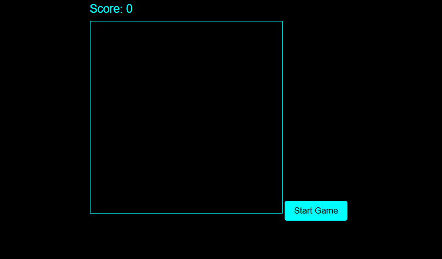
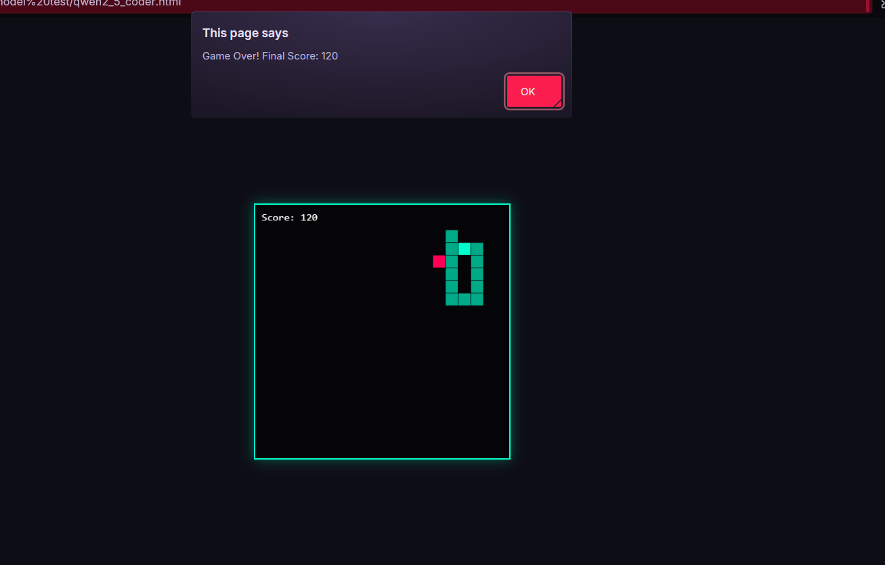
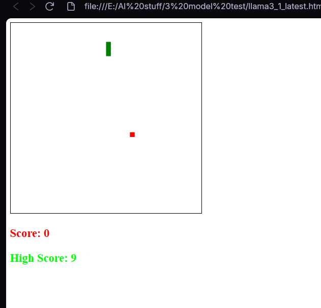

tested 3 models 

* deepseek r1 14b model
* qwen 2.5 7b model
* lama 3.1:latest

all produced.. some codes.. 

# **prompt:**
    *Write a complete, single-file HTML/JavaScript snake game with arcade colors. Give me only the code so I can save it as an .html file and double-click to play.*

# Review of the games:

* **deepseek r1 14B -**
    * color palette - it had a nice cyber theme, great attempt.
    *  unfortunately failed as the "start game" button doees not work.

* **qwen 2.5 coder 7b -**
     * fabulous job for one prompt.
     * used neon-ish green and red for the theme
     * bit on the higher end in speed
     * self cross over is not allowed
     * hitting the edge ends the game and shows your finally score in a pop up with a ok button.

* **llama 3.1 latest -**
     * uncentered screen
     * allows self cross over
     * white background, simple red and green colors
     * has a high score feature(which is only for that instance..)
     * no popup after game over
     * bigger arena
     * similar speed?


# **responses:**
* **deepseek-r1 14B model -**

**Code:** [deepseek snake code](deepseek.html)

This is a complete, self-contained snake game with the following features:
1. Neon color scheme reminiscent of arcade games
2. Score tracking
3. Start/restart functionality
4. Game over detection
5. Responsive controls using arrow keys
6. Clean, modern styling with CSS

To play:
1. Save this code as an .html file (e.g., "snake.html")
2. Double-click the file to open in your web browser
3. Click "Start Game"
4. Use arrow keys to control the snake
5. Try to eat the cyan squares to grow and increase your score
6. Avoid hitting the walls or yourself

The snake will be green (with the head in light green), and the food will be cyan on a black background. The score is shown in blue above the game board.




* **qwen coder 2.5 7B -**

**Code:** [qwen coder 2.5 7B](qwen2_5_coder.html)

***Note:** qwen coder outputed this without formating. the above is the code after reformat. also it did not put it inside a "```bash".. and originally it looked like this...(added it into bash for easier access )*

```bash
{"name": "store", "arguments": {"action": "store", "content": "<!DOCTYPE html>\n<html lang=\"en\">\n<head>\n<meta charset=\"UTF-8\">\n<meta name=\"viewport\" content=\"width=device-width, initial-scale=1.0\">\n<title>Snake Game</title>\n<style>\n  body {\n    margin: 0;\n    display: flex;\n    justify-content: center;\n    align-items: center;\n    height: 100vh;\n    background-color: #000;\n  }\n  canvas {\n    border: 1px solid #fff;\n  }\n</style>\n</head>\n<body>\n<canvas id=\"gameCanvas\" width=\"400\" height=\"400\"></canvas>\n<script>\n  const canvas = document.getElementById('gameCanvas');\n  const ctx = canvas.getContext('2d');\n  const scale = 20;\n  const rows = canvas.height / scale;\n  const columns = canvas.width / scale;\n\n  const directions = {\n    ArrowUp: { x: 0, y: -1 },\n    ArrowDown: { x: 0, y: 1 },\n    ArrowLeft: { x: -1, y: 0 },\n    ArrowRight: { x: 1, y: 0 }\n  };\n\n  let snake = [{ x: 10, y: 10 }];\n  let direction = directions.ArrowRight;\n  let food = { x: Math.floor(Math.random() * columns), y: Math.floor(Math.random() * rows) };\n  let score = 0;\n\n  function draw() {\n    ctx.clearRect(0, 0, canvas.width, canvas.height);\n\n    snake.forEach(segment => {\n      ctx.fillStyle = '#0f0';\n      ctx.fillRect(segment.x * scale, segment.y * scale, scale, scale);\n    });\n\n    ctx.fillStyle = '#f00';\n    ctx.fillRect(food.x * scale, food.y * scale, scale, scale);\n\n    ctx.fillStyle = '#fff';\n    ctx.font = '20px Arial';\n    ctx.fillText(`Score: ${score}`, 10, 20);\n  }\n\n  function update() {\n    const head = { x: snake[0].x + direction.x, y: snake[0].y + direction.y };\n\n    if (head.x === food.x && head.y === food.y) {\n      food = { x: Math.floor(Math.random() * columns), y: Math.floor(Math.random() * rows) };\n      score++;\n    } else {\n      snake.pop();\n    }\n\n    if (head.x < 0 || head.x >= columns || head.y < 0 || head.y >= rows || snake.some(segment => segment.x === head.x && segment.y === head.y)) {\n      alert(`Game Over! Your score: ${score}\nClick to play again!`);\n      location.reload();\n      return;\n    }\n\n    snake.unshift(head);\n  }\n\n  function gameLoop() {\n    update();\n    draw();\n    setTimeout(gameLoop, 100);\n  }\n\n  document.addEventListener('keydown', event => {\n    direction = directions[event.key];\n  });\n\n  gameLoop();\n</script>\n</body>\n</html>"}}
```



* **llama 3.1 latest -**

**Code:** [llama 3.1 latest](llama3_1_latest.html)

This code creates a canvas element and gets the 2D drawing context. It then defines the snake and food variables, as well as the movement and score variables. The game loop function is defined, which clears the canvas, draws the snake and food, updates the snake position, checks for collision with food or wall, and updates the score display. The event listeners for keyboard input are added, and the game loop is started.


